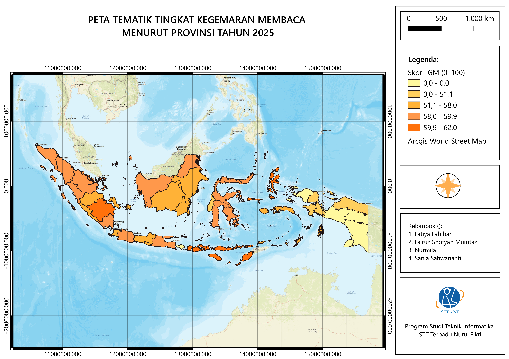
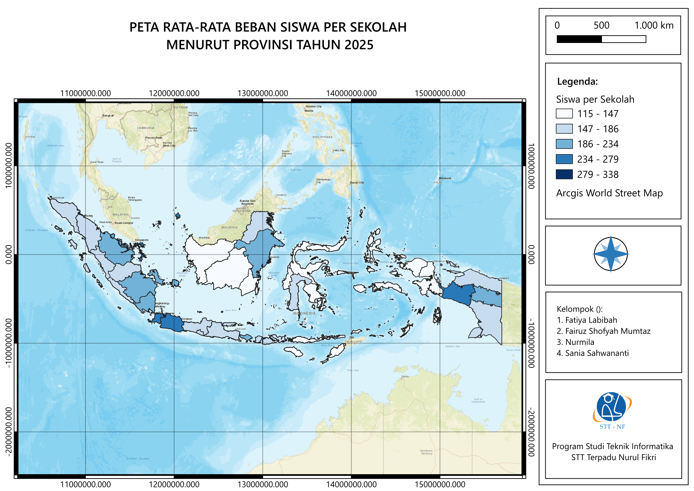
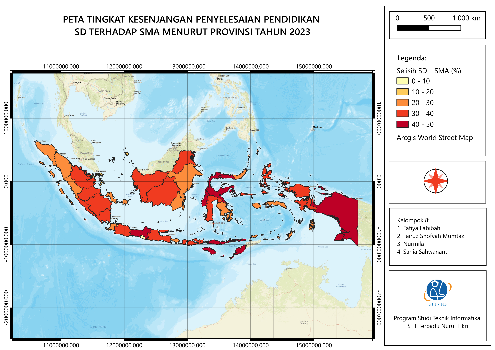
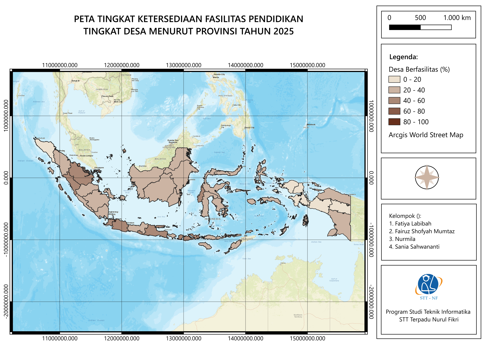
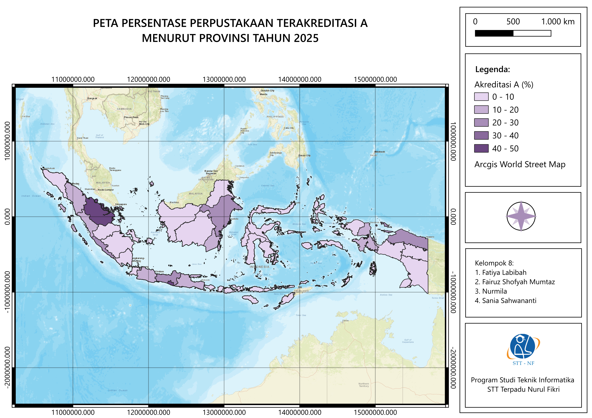

# Pemetaan Tematik Pendidikan & Literasi Indonesia Berbasis QGIS

Pernah lihat tabel data BPS yang isinya deretan angka puluhan ribu baris? Sekilas memang bikin pusing. Lewat proyek Sistem Informasi Geografis (SIG) ini, data statistik pendidikan dan literasi di 38 provinsi Indonesia kami ubah jadi peta tematik visual yang interaktif, bergradasi warna, dan langsung enak dibaca.

Proyek ini digarap menggunakan **QGIS** dan **Microsoft Excel** dengan basis data resmi dari **Badan Pusat Statistik (BPS)**.

---

## 5 Peta Tematik & Cerita di Baliknya

Berikut lima visualisasi peta tematik yang berhasil kami susun beserta temuan menarik di setiap indikatornya:

---

### 1. Tingkat Kegemaran Membaca (TGM) 2025
Tingkat minat baca masyarakat diukur dalam skala 0–100 berdasarkan durasi, frekuensi, dan jumlah buku yang dibaca per minggu.



* **Fakta Menarik:** Wilayah Nusa Tenggara Timur (62,05) dan Nusa Tenggara Barat (61,19) justru menduduki peringkat teratas nasional, mengungguli kota-kota besar di Pulau Jawa. Ini bukti bahwa antusiasme literasi daerah berkembang pesat berkat gerakan komunitas baca lokal.

---

### 2. Rata-Rata Beban Siswa per Sekolah (2025)
Menghitung rata-rata beban kapasitas ruang belajar dengan membagi total siswa (SD, SMP, SMA) terhadap jumlah sekolah yang ada di setiap provinsi.



* **Fakta Menarik:** Wilayah perkotaan padat seperti DKI Jakarta menjadi yang paling sesak dengan rata-rata 338 siswa per sekolah, disusul Banten (279) dan Jawa Barat (265). Sebaliknya, mayoritas wilayah luar Jawa memiliki rasio yang jauh lebih longgar (di bawah 186 siswa/sekolah).

---

### 3. Kesenjangan Lulusan SD vs SMA (2023)
Melihat selisih antara persentase warga yang lulus SD dengan warga yang berhasil menyelesaikan jenjang SMA (basis 34 provinsi).



* **Fakta Menarik:** Masalah pendidikan kita saat ini bukan lagi soal bisa masuk SD atau tidak, melainkan sanggup lanjut sampai SMA atau terhenti di tengah jalan. Kesenjangan paling lebar terjadi di NTT (49,95%), sedangkan DI Yogyakarta (9,26%) memiliki tingkat keberlanjutan sekolah terbaik.

---

### 4. Ketersediaan Fasilitas Sekolah Tingkat Desa (2025)
Memetakan persentase desa atau kelurahan yang sudah memiliki gedung SMP, SMA, atau perguruan tinggi di wilayahnya.



* **Fakta Menarik:** DKI Jakarta unggul jauh dengan 80,45% kelurahannya memiliki sekolah lanjutan. Sementara itu, 23 provinsi masih berada di rentang 20%–40%, dan kawasan pedalaman Papua masih di bawah 20%. Artinya, anak-anak di desa masih harus menempuh jarak cukup jauh ke pusat kota untuk sekolah menengah.

---

### 5. Mutu Perpustakaan (Persentase Akreditasi A) 2025
Menampilkan persentase perpustakaan sekolah maupun daerah yang sudah mengantongi akreditasi mutu tertinggi (Predikat A).



* **Fakta Menarik:** Provinsi Riau (49,46%) dan DI Yogyakarta (42,70%) jadi juara dalam hal standar tata kelola perpustakaan unggul. Namun secara umum, ada 24 provinsi yang persentase akreditasi A-nya masih di bawah 10%, menandakan standarisasi sarana literasi masih jadi PR bersama.

---

## Data & Alat yang Digunakan

* **Aplikasi GIS:** QGIS 3.x / 4.x (Pengolahan layer GeoJSON, simbologi graduated natural breaks, dan layout print composer)
* **Pengolahan Data:** Microsoft Excel (Pembersihan tabel data statistik dan rasio matematis)
* **Sumber Data:** 100% Data Publik Badan Pusat Statistik (BPS) Republik Indonesia tahun 2023 & 2025
* **Peta Dasar Wilayah:** Peta Batas Administrasi Provinsi Indonesia (GeoJSON format)

---

## Struktur Folder Proyek

```text
├── 01_data_mentah/        # Tabel data mentah BPS (.xlsx, .csv) & poligon batas provinsi
├── 02_data_bersih/        # Data GeoJSON bersih yang sudah terintegrasi atribut angka
├── 03_peta_tematik/       # File proyek QGIS (.qgz) tiap anggota kelompok
├── 04_peta_export/        # Hasil ekspor peta resolusi tinggi (.png dan .pdf)
├── 05_template_layout/    # Template komposisi layout peta (.qpt)
└── 06_laporan/            # Laporan akademik lengkap (.docx & .pdf)
```

---

## Tim Penyusun

Proyek ini disusun untuk memenuhi tugas mata kuliah **Sistem Informasi Geografis (SIG - 7TI01)**, Program Studi Teknik Informatika, STT Terpadu Nurul Fikri (2026).

**Dosen Pengampu:** Dr. Sirojul Munir, S.Si., M.Kom.

**Kelompok 8:**
* **Fatiya Labibah** — 0110223060
* **Fairuz Shofyah Mumtaz** — 0110223063
* **Sania Sahwananti** — 0110223055
* **Nurmila** — 0110223297
